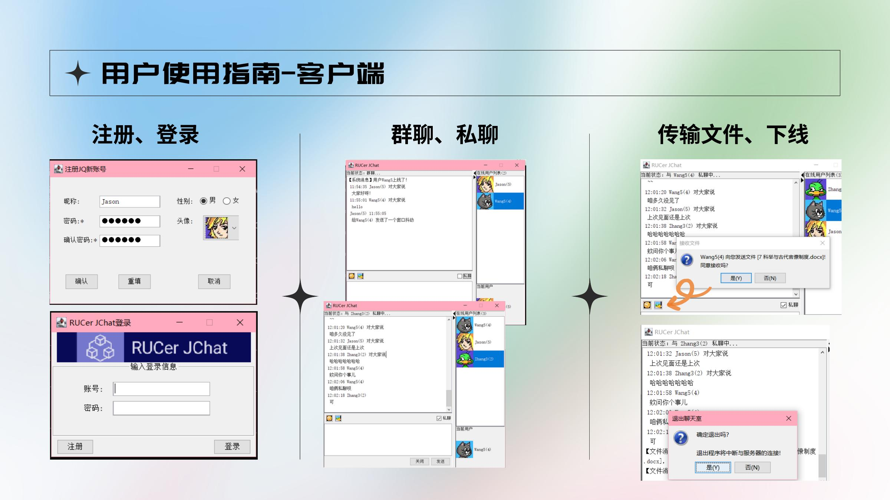
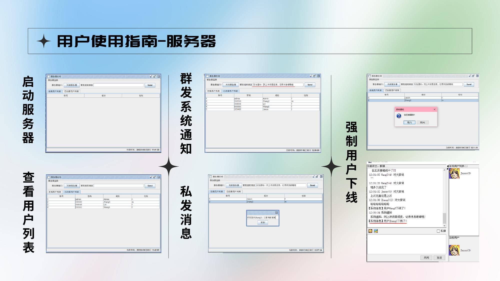

# Java Socket Chatroom

[](https://github.com/jetfan-xin/java-socket-chatroom/actions/workflows/ci.yml)

A desktop client-server chat application built with **Java 17**, **TCP sockets**, **concurrent collections**, **object streams**, and **Swing**. This repository turns a 2023 team coursework project into a reproducible, English-language portfolio project while preserving its original networking and GUI features.

## What it demonstrates

- Multi-client TCP server with a dedicated request-processing task per connection
- Registration and login backed by local serialized storage
- Public chat, private chat, online-presence events, and server announcements
- Direct file transfer with an explicit accept/refuse handshake
- Swing client and server administration interfaces
- Thread-safe online-session registries and copy-on-write user lists
- Dependency-free build scripts, smoke tests, and GitHub Actions CI

## Portfolio refactor highlights

The 2026 refactor keeps the original feature set while making the repository easier to review and run:

- Migrated the source to the conventional `dev.jingfan.jchat.*` package namespace and Maven layout
- Replaced missing image files with deterministic Java2D avatar rendering
- Added a cached connection-handler pool and synchronized object-stream writes
- Fixed list-removal bounds, gender mapping, empty-database startup, and stale-session cleanup defects
- Removed passwords from logs and the server administration table
- Moved asynchronous Swing updates onto the Event Dispatch Thread
- Added 23 automated checks, including a real two-client loopback test for login, presence, public-chat delivery, and logout

## Original interface

The source archive no longer contained its referenced avatar and toolbar image files. The refactor keeps the Swing interface and replaces those missing assets with programmatically rendered icons. These screenshots from the original June 2023 project report document the working client and server UI.

| Client workflows | Server administration |
| --- | --- |
|  |  |

See [the architecture guide](docs/ARCHITECTURE.md) for component and message-flow diagrams.

## Run locally

Requirements: JDK 17 or newer. No runtime dependencies are required.

```bash
git clone https://github.com/jetfan-xin/java-socket-chatroom.git
cd java-socket-chatroom
./scripts/run-server.sh
```

Open another terminal for each client:

```bash
./scripts/run-client.sh
```

On first server start, the application creates `data/users.db` with demo accounts:

| Account | Password | Display name |
| --- | --- | --- |
| `1` | `admin` | Admin |
| `2` | `333333` | Zhang |
| `3` | `444444` | Li |
| `4` | `555555` | Wang |

The default endpoint is `localhost:6666`. Change it in `src/main/resources/serverconfig.properties` before compiling.

## Build and test

The repository supports both Maven and a dependency-free shell workflow:

```bash
mvn verify
./scripts/test.sh
```

The smoke tests exercise request/response serialization, list models, generated avatars, user persistence, and a real two-client socket flow without opening desktop windows.

## Repository layout

```text
src/main/java/       Application source
src/main/resources/  Server and client configuration
src/test/java/       Dependency-free smoke tests
scripts/             Compile, test, and launch commands
docs/                Architecture notes and original UI evidence
```

## Scope and security

This application is designed for local demonstration and learning. Its Java object-serialization protocol and unencrypted sockets must not be exposed to untrusted networks. A production version would use TLS, a versioned message format, credential hashing, database migrations, and stricter file-transfer validation.

## Credits

The original coursework was built by Jingfan Xin and Cui Yiwen. The exact ownership split and the later portfolio changes are documented in [NOTICE.md](NOTICE.md). The repository intentionally carries no open-source license because the original work was collaborative.
