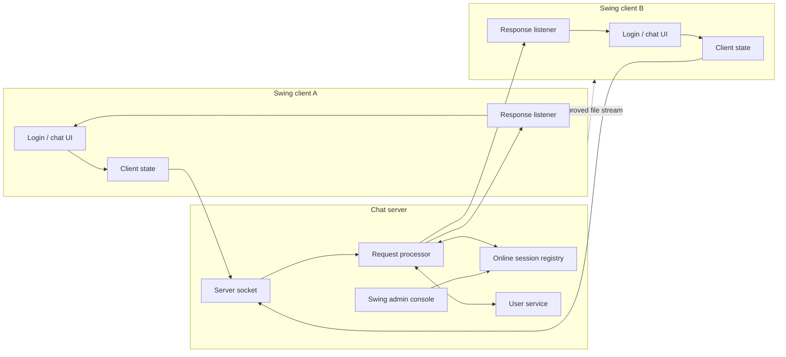
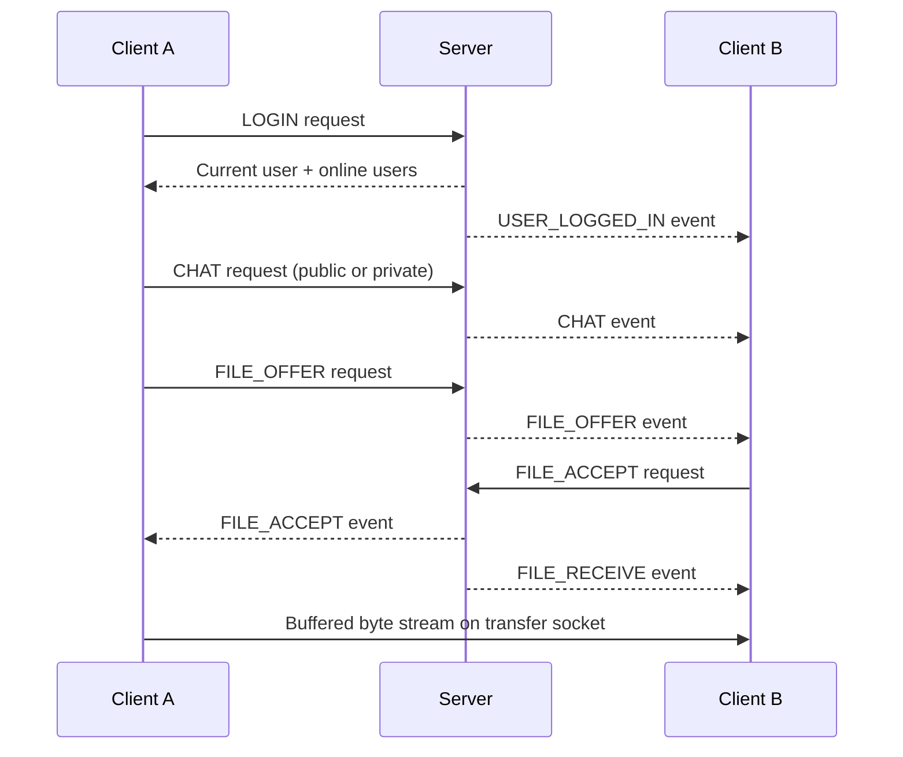

# Architecture

The application follows a classic desktop client-server design. A single TCP connection carries serialized request and response objects for account and chat events. A separate peer-to-peer socket is opened only after both users agree to a file transfer.

## Message flow

## Deliberate boundaries

- This is a local-network learning project, not a production chat service.
- Java object serialization and an unencrypted socket protocol are retained from the coursework for provenance and simplicity.
- Runtime user data is stored locally under `data/` and is excluded from version control.
- Swing state is updated on the Event Dispatch Thread where the refactor touches asynchronous callbacks.
